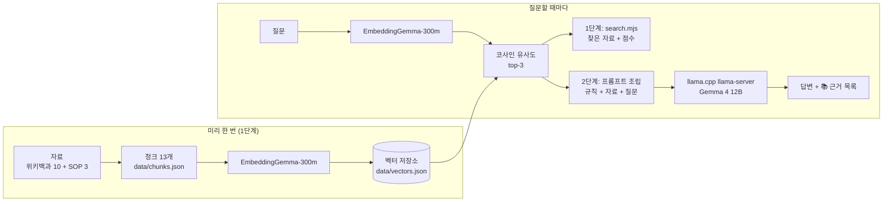

# 물류창고 재고 조사 안내 챗봇 (로컬 RAG)

물류창고에 새로 온 작업자가 재고 실사 절차와 용어를 물으면, **현장 SOP와 위키백과 자료를 찾아 근거와 함께 안내**하는 챗봇입니다.
내 PC에서만 돌아가는 Node.js CLI이며, 서버·웹 화면·배포는 없습니다.

- **답하는 것**: 재고 실사 절차(순환재고조사, 실사 차이 처리, 안전 수칙), 재고·WMS·ABC 분석·선입선출법·RFID 같은 용어
- **답하지 않는 것**: 실시간 재고 수량(예: "A-01 재고 몇 개야?")은 이 챗봇의 자료에 없습니다. 실시간 수량은 **WMS(창고 관리 시스템)** 에서 확인합니다.

> 과제 가이드: 「물류창고 재고 조사 안내 챗봇: 내 PC에서 끝나는 RAG 2단계」. 가이드와 다르게 한 부분은 아래 [설계 결정](#설계-결정-가이드와-다른-점)에 적었습니다.

---

## 1. 동작 원리



1. 자료를 **사실 하나씩** 잘라 청크 13개를 만들고, 청크마다 출처(url)를 함께 보관합니다.
2. 임베딩 모델이 청크마다 **숫자 768개짜리 벡터**를 만들고 길이를 1로 맞춥니다. 뜻이 비슷한 문장일수록 벡터의 방향이 비슷합니다.
3. 질문도 같은 모델로 벡터를 만든 뒤, 모든 청크와 내적(= 코사인 유사도)을 계산해 점수가 높은 3개를 고릅니다. **여기까지가 1단계(검색)** 입니다.
4. 2단계에서는 찾은 청크와 질문을 "자료에 근거해서만 답하고 ID를 [WH-012]처럼 달아라"는 규칙과 함께 LLM에 넘깁니다.
5. 답변은 생성되는 대로 화면에 출력되고(스트리밍), 끝나면 **프로그램이 직접** LLM에게 넘긴 자료 목록을 보여 줍니다. 답변에 ID가 적힌 자료에는 ✓를 붙입니다.

---

## 2. 사용 기술

| 구분 | 사용한 것 |
|---|---|
| 실행 환경 | Node.js v26.7.0, ES 모듈(`src/*.mjs`), Windows |
| 임베딩 라이브러리 | transformers.js `@huggingface/transformers` 4.3.1 |
| 임베딩 모델 | `onnx-community/embeddinggemma-300m-ONNX`, dtype `q8`(약 309MB), mean pooling + 정규화, 768차원 |
| 임베딩 입력 형식 | 모델 카드 공식 형식. 문서 `title: {section} \| text: {text}`, 질문 `task: search result \| query: {질문}` |
| LLM (2단계) | llama.cpp `llama-server`(빌드 b11429) + `gemma-4-12B-it-QAT-Q4_0.gguf`, `http://127.0.0.1:8080` |
| LLM 호출 | OpenAI 호환 `POST /v1/chat/completions`, SSE 스트리밍, `temperature: 0`, 생각 모드 OFF(`chat_template_kwargs: { enable_thinking: false }`) |

---

## 3. 실행 방법

### 준비

```powershell
npm install
```

- 처음 임베딩할 때 모델 약 309MB를 내려받습니다(`node_modules/@huggingface/transformers/.cache/`).
- 2단계(`ask.mjs`)를 쓰려면 llama.cpp `llama-server`를 `8080` 포트로 켜 둡니다. 주소를 바꾸려면 환경변수 `LLM_BASE_URL`을 씁니다.
- 한글이 깨지면 PowerShell에서 `[Console]::OutputEncoding = [Text.Encoding]::UTF8`

### 1단계: 벡터 저장소 만들기 → 검색

```powershell
node src/build-index.mjs
node src/search.mjs "재고 실사 차이가 나면 어떻게 처리해?" "ABC 분석이 뭐야?" "내일 날씨 어때?"
```

- `build-index.mjs`: `data/chunks.json`을 검사(필드 누락·중복 id는 중단, 120자 미만은 경고)한 뒤 `data/vectors.json`을 만듭니다. 청크를 고치면 다시 실행해야 합니다.
- `search.mjs`: 질문 여러 개를 한 번에 넣을 수 있습니다. `--k 5`로 결과 개수를 바꿉니다. 1위 점수가 0.55 미만이면 `⚠ 관련 자료가 약함`이 붙습니다.

### 2단계: 답변 받기

```powershell
node src/ask.mjs "재고 실사 차이가 나면 어떻게 처리해?"
```

| 옵션 | 뜻 |
|---|---|
| `--k 3` | LLM에게 넘길 청크 개수(기본 3) |
| `--show-prompt` | LLM을 부르지 않고, 조립된 system/user 메시지만 출력. 서버 없이 동작 |
| `--no-rag` | 검색도 시스템 메시지도 없이 질문만 LLM에 보냄(RAG 효과 비교용) |

출력 예시(실제 실행 결과, `실험/결과/실행기록/STEP7_실사차이.txt`):

```text
🔎 검색 결과
  WH-012  0.798  실사 차이 처리
  WH-004  0.614  재고수량 결정
  WH-001  0.610  재고의 정의
💬 답변
실사 수량과 WMS 장부 수량이 다르면 즉시 조정하지 않고 다른 조사자가 같은 로케이션을 재실사합니다 [WH-012]. 재실사 후에도 차이가 남으면 입고 전표, 로케이션 이동 이력, 출고 피킹 기록 순서로 확인합니다 [WH-012]. …
📚 근거 (LLM에게 넘긴 자료 · ✓ = 답변에 ID가 표시된 자료)
  ✓ WH-012  실사 차이 처리  docs/sop.md#실사-차이-처리
    WH-004  재고수량 결정  https://ko.wikipedia.org/wiki/%EC%9E%AC%EA%B3%A0%EA%B4%80%EB%A6%AC
    WH-001  재고의 정의  https://ko.wikipedia.org/wiki/%EC%9E%AC%EA%B3%A0
🧠 모델 gemma-4-12B-it-QAT-Q4_0.gguf · 입력 690토큰 · 출력 148토큰 · 생각 내용 0자
⏱ 검색 3.4초 · 답변 20.2초
```

### 파일 구조

```text
warehouse-rag/
├─ 📋 명세서.md            설계 계약(데이터·임베딩·검색·생성) + 진행 현황 + 원본 기록
├─ docs/sop.md             현장 SOP (교육용 예시)
├─ data/chunks.json        청크 원본 13개
├─ data/vectors.json       벡터 저장소 (13 × 768)
├─ src/embedder.mjs        임베딩 공통 모듈 (모델·설정은 여기에만)
├─ src/build-index.mjs     청크 → 벡터 저장소
├─ src/search.mjs          [1단계] 검색기, WEAK_THRESHOLD = 0.55
├─ src/prompt.mjs          시스템 메시지와 프롬프트 조립
├─ src/llm.mjs             llama-server 연결 확인·SSE 스트리밍 (가이드의 ollama.mjs 자리)
├─ src/ask.mjs             [2단계] 검색 + 프롬프트 + 답변 + 근거 목록
└─ 실험/                    임베딩 방식 비교, STEP 8 비교 실험 스크립트와 실행 원문
```

---

## 4. 자료(청크)

### 청크 설계 원칙

1. **한 청크에 사실 하나.** 주제가 섞이면 엉뚱한 질문에도 걸립니다.
2. **혼자 읽어도 뜻이 통하게.** 앞 문맥이 필요한 문장으로 시작하지 않습니다. 최소 120자.
3. **원문에 없는 말을 보태지 않기.** 위키백과 청크는 원문 문장을 그대로 이어 붙였고, 원문에 포함되는지를 스크립트로 자동 대조했습니다(10개 모두 통과).

### 청크 목록

| id | section | 글자 수 | 출처 |
|---|---|---:|---|
| WH-001 | 재고의 정의 | 147 | [위키백과 재고](https://ko.wikipedia.org/wiki/%EC%9E%AC%EA%B3%A0) |
| WH-002 | 재고관리의 대상 | 148 | [위키백과 재고관리](https://ko.wikipedia.org/wiki/%EC%9E%AC%EA%B3%A0%EA%B4%80%EB%A6%AC) |
| WH-003 | 재고관리의 목적 | 149 | [위키백과 재고관리](https://ko.wikipedia.org/wiki/%EC%9E%AC%EA%B3%A0%EA%B4%80%EB%A6%AC) |
| WH-004 | 재고수량 결정 | 284 | [위키백과 재고관리](https://ko.wikipedia.org/wiki/%EC%9E%AC%EA%B3%A0%EA%B4%80%EB%A6%AC) |
| WH-005 | 창고 관리 시스템(WMS)의 정의 | 153 | [위키백과 창고 관리 시스템](https://ko.wikipedia.org/wiki/%EC%B0%BD%EA%B3%A0_%EA%B4%80%EB%A6%AC_%EC%8B%9C%EC%8A%A4%ED%85%9C) |
| WH-006 | WMS의 핵심 기능 | 201 | [위키백과 창고 관리 시스템](https://ko.wikipedia.org/wiki/%EC%B0%BD%EA%B3%A0_%EA%B4%80%EB%A6%AC_%EC%8B%9C%EC%8A%A4%ED%85%9C) |
| WH-007 | ABC 분석 | 274 | [위키백과 ABC 분석](https://ko.wikipedia.org/wiki/ABC_%EB%B6%84%EC%84%9D) |
| WH-008 | 선입선출법(FIFO) | 159 | [위키백과 선입 선출법과 후입 선출법](https://ko.wikipedia.org/wiki/%EC%84%A0%EC%9E%85_%EC%84%A0%EC%B6%9C%EB%B2%95%EA%B3%BC_%ED%9B%84%EC%9E%85_%EC%84%A0%EC%B6%9C%EB%B2%95) |
| WH-009 | 재고자산의 정의와 종류 | 178 | [위키백과 재고자산](https://ko.wikipedia.org/wiki/%EC%9E%AC%EA%B3%A0%EC%9E%90%EC%82%B0) |
| WH-010 | RFID와 바코드 | 213 | [위키백과 RFID](https://ko.wikipedia.org/wiki/RFID) |
| WH-011 | 순환재고조사 | 229 | `docs/sop.md#순환재고조사` |
| WH-012 | 실사 차이 처리 | 213 | `docs/sop.md#실사-차이-처리` |
| WH-013 | 안전 수칙 | 228 | `docs/sop.md#안전-수칙` |

- 위키백과 원문은 위키백과 공식 API(`action=query&prop=extracts`)로 2026-10-13에 받아 읽었습니다.
- 가이드의 `창고관리시스템`, `선입선출법` 주소는 넘겨주기(redirect) 문서라서, 실제 도착 문서의 주소를 적었습니다.
- WH-004는 원문 수식 표기에 남은 위키 마크업 기호(`` ` ``)만 지웠습니다.
- `docs/sop.md`는 **교육용 예시 SOP** 입니다. 조사 주기(A 월 1회·B 분기 1회·C 반기 1회)와 승인자(창고 관리자)는 예시 값입니다.

---

## 5. 설계 결정 (가이드와 다른 점)

| 항목 | 가이드 | 이 프로젝트 | 이유 |
|---|---|---|---|
| LLM | Ollama `qwen3.5:2b`, `/api/chat`, NDJSON | llama.cpp `llama-server` + Gemma 4 12B, `/v1/chat/completions`, SSE | 내 PC에서 쓰는 로컬 LLM 실행기가 llama.cpp라서. 응답 형식이 달라 `ollama.mjs` 대신 `llm.mjs`를 만들었습니다 |
| 생각 모드 끄기 | `think: false` | 요청마다 `chat_template_kwargs: { enable_thinking: false }` | Gemma 4는 채팅 양식(chat template)의 스위치로 생각 모드를 켜고 끕니다 |
| 연결 확인 | `GET /api/tags` | `GET /health` | llama-server는 모델 로딩 중이면 503을 돌려줍니다 |
| 설계 계약 문서 | `CLAUDE.md` | `📋 명세서.md` | 코드는 Claude Code CLI가 아닌 다른 AI 에이전트와 진행했고, CLAUDE.md 대신 명세서 한 파일에 계약과 진행 현황을 함께 기록했습니다 |
| 모델 이름 표시 | 고정값 `qwen3.5:2b` | 서버 `/props`의 `model_path`에서 읽음 | 이 서버의 `/v1/models`는 실행 시 붙은 별칭(`Qwen 3.8 27B`)을 돌려줘 실제 모델과 달랐습니다 |

### 생각 모드 OFF 확인 (실측)

같은 질문("17 × 23은? 숫자만 답해.", temperature 0)을 스위치만 바꿔 보냈습니다.

| `enable_thinking` | 생각 내용 | 출력 토큰 | 걸린 시간 | 답 |
|---|---:|---:|---:|---|
| `true` | 222자 | 113 | 16.3초 | 391 |
| `false` | 0자 | 4 | 1.6초 | 391 |

### 임베딩 벡터를 만드는 두 방식 비교 (실측)

모델 카드의 예시 코드는 가이드와 달리 모델의 `sentence_embedding` 출력을 그대로 씁니다. 같은 모델·q8·접두어로 두 방식을 비교했습니다(`node 실험/임베딩_방식_비교.mjs`, 질문 9개).

| | A 가이드 방식 (pipeline + mean pooling) | B 모델 카드 방식 (sentence_embedding) |
|---|---|---|
| 관련 질문 1위 점수 | 0.663~0.812 | 0.482~0.733 |
| 도메인 밖(A-01 재고) | 0.542 | 0.333 |
| 무관(날씨·요리) | 0.432~0.449 | 0.123~0.126 |
| 간격(관련 최저 − 무관 최고) | 0.214 | 0.356 |
| 1위 청크 | 9개 중 8개가 같음 | |

- B가 관련/무관을 더 뚜렷하게 가르지만, 점수의 눈금이 달라 B를 쓰려면 기준점(0.55)을 새로 정해야 합니다(B에서는 관련 질문인 "A등급 품목은 얼마나 자주 세?"도 0.482).
- **결정: A 가이드 방식 + 기준점 0.55 유지.** 가이드와 같은 조건으로 결과를 비교하기 위해서입니다. 질문 9개뿐인 작은 표본이라 B가 항상 낫다고 단정하지 않았습니다.

---

## 6. 1단계 관찰 기록

`node src/search.mjs` 실측(2026-10-13, 13청크, 가이드 방식 q8):

| # | 질문 | 유형 | 1위 청크 | 점수 | 2위 | 관찰 |
|---|---|---|---|---|---|---|
| 1 | 재고 실사 차이가 나면 어떻게 처리해? | 정상 | WH-012 실사 차이 처리 | 0.798 | WH-004 0.614 | 정확히 찾음 |
| 2 | 실사 수량이 장부랑 안 맞으면? | 다른 표현 | WH-012 실사 차이 처리 | 0.716 | WH-004 0.610 | "차이·처리" 단어 없이도 같은 청크 |
| 3 | ABC 분석이 뭐야? | 정상 | WH-007 ABC 분석 | 0.752 | WH-011 0.551 | |
| 4 | RFID랑 바코드 차이 | 정상 | WH-010 RFID와 바코드 | 0.812 | WH-008 0.494 | 1·2위 차이가 가장 큼 |
| 5 | 안전재고는 어떻게 계산해? | 경계 | WH-004 재고수량 결정 | 0.691 | WH-001 0.630 | "안전재고" 단어는 없지만 예비량 k 청크를 찾음. 3위 안전 수칙 0.598("안전"에 끌림) |
| 6 | A등급 품목은 얼마나 자주 세? | 경계 | WH-011 순환재고조사 | 0.663 | WH-007 0.627 | 답에 두 청크가 필요 |
| 7 | 우리 창고 지금 A-01 재고 몇 개야? | 도메인 밖 | WH-011 순환재고조사 | 0.542 ⚠ | WH-001 0.541 | 가이드(0.553, ⚠ 없음)와 달리 기준 바로 아래. 1~3위 차이 0.007로 뚜렷한 1위가 없음 |
| 8 | 내일 날씨 어때? | 무관 | WH-004 재고수량 결정 | 0.449 ⚠ | WH-011 0.420 | |
| 9 | 김치찌개 레시피 알려줘 | 무관 | WH-004 재고수량 결정 | 0.432 ⚠ | WH-013 0.373 | |

### 생각해 볼 것 (내 답)

1. **단어가 겹치지 않아도 찾을 수 있는 이유는?**
   단어가 안 겹쳐도 의미가 비슷하다면 당연히 찾을 수 있는 것.
2. **무관한 질문에도 1위는 나오는데, 점수 기준(0.55)은 왜 필요한가?**
   점수 기준은 의미 없는 청크가 실제 답변에 의미 없이 참고되지 않도록 하는 것.
3. **점수 기준만으로 "실시간 수량은 자료에 없다"를 걸러도 될까?**
   환각/시스템상의 설정 문제 때문에 DB에 충분한 데이터가 있음에도 참고를 하지 않는 경우도 충분히 발생 가능. 더블 체크 해 주는 게 가장 안전하지만 해당 부분까지 LLM에게 위임하는 게 RAG가 지향하는 진짜 방향이 아닐까 싶다.
4. **5번처럼 단어 하나("안전")에 끌려 엉뚱한 청크가 올라오면?**
   관련 없는 게 높은 점수를 받았다는 것은 LLM이 관련 없는 자료를 참고하고 답변하게 될 거라는 것. 막기 위해 threshold를 더 높이거나, 자료의 양을 더 늘리거나, 더 큰 모델을 사용하는 등 여러 방안으로 예방하면 될 것 같다.

> 구현 메모: 현재 기준점은 **1위 점수에만** 적용되고 결과를 버리지 않습니다(경고·보수 문구만). 그래서 2·3위의 엉뚱한 청크는 기준점을 올려도 LLM에게 그대로 넘어갑니다.

---

## 7. 2단계 비교 실험 기록

### 시스템 메시지 (직접 작성)

```text
당신은 물류창고 재고 조사 안내 도우미입니다. 주어진 자료에 근거해서만 답합니다.
주어진 자료와 관련이 없다고 판단되는 질문에는 자료에 없는 내용이라고 사용자에게 알리고 답변하지 않습니다.
근거로 쓴 자료의 ID를 [WH-012]처럼 대괄호로 감싸 해당 문장 끝에 항상 표시합니다.
```

가이드 예시와 달리 "실시간 수량은 WMS에서 확인하라"는 안내 문장은 넣지 않았습니다.

### RAG 없이 vs RAG

실측: 2026-10-13, Gemma 4 12B QAT Q4_0, temperature 0, 생각 OFF. 원문은 `실험/결과/실행기록/STEP8_*.txt`. 시간은 요청부터 마지막 글자까지(프롬프트 처리 포함).

| 질문 | RAG 없이 (핵심 문장) | RAG (핵심 문장) | [WH-xxx] 표시 | 지어낸 내용? | 내 판단 |
|---|---|---|---|---|---|
| 재고 실사 차이가 나면 어떻게 처리해? | "원인 파악 → 조정 절차 → 재발 방지" 3단계 일반론. 재고감모 계정 처리, 2인 교차 확인 등 (835토큰, 38.1초) | SOP 그대로: 재실사 → 입고 전표·이동 이력·피킹 기록 확인 → 5가지 원인 분류 → 관리자 승인 후 WMS 반영 (148토큰, 22.3초) | 4문장 모두 [WH-012] | RAG 없음: 우리 SOP와 다른 일반 절차. RAG: 없음 | RAG 없는 것은 당연하게도 일반론적인 얘기를 상세하게 해 주고, RAG 있는 것은 제공된 자료 기반으로 잘 답변했다. 결과적으로 RAG 구성 성공. |
| A등급 품목은 얼마나 자주 세? | "매월 또는 매주", B 분기·C 반기 또는 연 1회, "A등급은 재고 금액의 약 70~80%" (668토큰, 32.9초) | "A등급 품목은 월 1회 조사합니다." (20토큰, 17.6초) | [WH-011] | RAG 없음: 우리 창고 기준을 몰라 하나로 정하지 못함. "70~80%"는 우리 자료(WH-007: 5∼10% 품목이 50∼80%)로는 확인할 수 없는 수치. RAG: 없음 | 두 번째도 제공받은 자료가 없으니 그냥 일반론적인 얘기. 당연하게도. |
| 우리 창고 지금 A-01 재고 몇 개야? | 숫자를 지어내지 않고 "재고 시스템에 접근 권한이 없다, WMS·엑셀에서 확인하라" (102토큰, 11.6초) | "자료에 해당 내용이 없습니다." ⚠ 약한 근거 (9토큰, 9.9초) | 없음 | 둘 다 없음. 단 RAG 답에는 WMS 안내가 빠짐 | 모델 사이즈가 작긴 하지만 일반적인 대화에 필요한 지식은 갖고 있어서, RAG 없이도 WMS라는 알맞은 안내를 제시했다. 사용자의 요구에 응할 수 없을 때 플랜 B를 제시하는 것은 보기 좋았다. RAG 있는 것은 제공받은 자료 중 알맞은 게 없다는 것을 판단해 잘 걸러냈다. |
| 내일 날씨 어때? | "실시간 기상 정보에 접근할 수 없다, 날씨 앱을 확인하라" (74토큰, 9.3초) | "자료에 없는 내용입니다." ⚠ 약한 근거 (8토큰, 9.8초) | 없음 | 둘 다 없음 | C와 같음: RAG 없는 것은 자료가 없으니 알아서 확인하라고 안내했고, RAG 있는 것은 알맞은 자료가 없다고 판단해 잘 걸러냈다. |

관찰 메모(실행 결과에서 확인한 사실):
- RAG 답은 짧고 근거 ID가 붙었습니다. RAG 없는 답은 길고 일반론이며 출처가 없었습니다.
- `--no-rag`는 시스템 메시지 없이 질문만 보냅니다(입력 20~27토큰). RAG 없이 나온 "WMS·날씨 앱을 확인하라" 안내는 모델 자체의 기본 행동입니다.
- A-01 질문에서 RAG 쪽은 거절은 지켰지만 WMS 안내는 하지 않았습니다. 시스템 메시지에 그 문장을 넣지 않았기 때문으로 보이며, 추가 실험은 하지 않았습니다.
- Gemma 4 12B는 RAG 없이도 A-01 수량과 날씨를 지어내지 않았습니다(가이드의 2B 실측과 다른 점).
- RAG 쪽은 답이 8~9토큰이어도 약 10초가 걸렸습니다. 입력 약 700토큰을 먼저 처리하기 때문으로 보이지만, 프롬프트 처리 시간을 따로 재지는 않았습니다.

---

## 8. 한계와 다음 단계

**한계**
- **검색 점수만으로는 "답이 자료에 있는지"를 알 수 없습니다.** 검색은 항상 가장 가까운 청크를 고릅니다. A-01 질문은 이번에 0.542로 기준 바로 아래였지만, 청크가 조금만 바뀌어도 기준을 넘을 수 있는 거리입니다.
- **기준점은 1위 점수에만 적용됩니다.** 2·3위의 관련 없는 청크(예: "안전재고" 질문의 3위 안전 수칙)도 LLM에게 넘어갑니다.
- **자료가 13청크뿐입니다.** SOP 3개는 교육용 예시이며 실제 현장 기준이 아닙니다.
- **실험 규모가 작습니다.** 관찰은 질문 9개, 비교는 질문 4개로 각각 한 번씩 실행한 결과입니다.
- 실행 결과는 서버 실행 환경(llama.cpp 빌드, 양자화, GPU)에 따라 달라질 수 있습니다.

**하지 않은 것**
- 가이드의 선택 실습(입고 검수 md 추가, BM25 하이브리드 검색, 대화형 모드, 프롬프트 한 줄 바꿔 보기)은 하지 않았습니다.
- 위키백과 원문 대조는 공식 API로 받은 원문과 스크립트로 자동 대조했습니다. 브라우저로 페이지를 하나씩 열어 보는 수동 대조는 별도로 하지 않았습니다.

**다음에 해 볼 것**
- 시스템 메시지에 "실시간 재고 수량은 WMS에서 확인하라"는 문장을 넣고 A-01 질문을 다시 비교하기
- 기준점 미만 청크는 LLM에게 넘기지 않는 규칙을 넣고 결과 비교하기
- 입고 검수 같은 자료를 추가한 뒤 STEP 5 질문을 다시 돌려 다른 질문의 결과가 바뀌는지 확인하기
- 모델 카드 방식(B)으로 기준점을 새로 정해 같은 실험 반복하기
